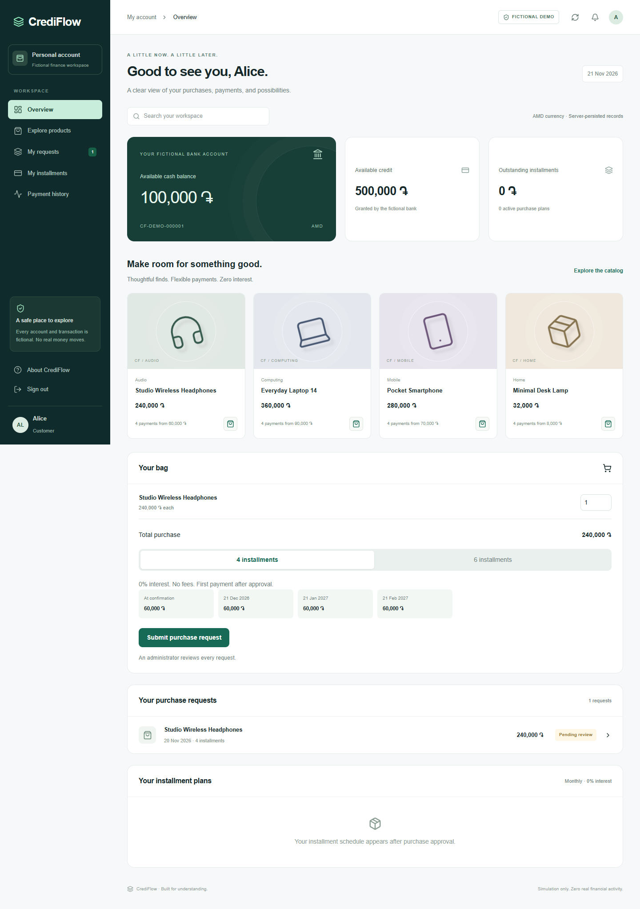

# CrediFlow

A fictional buy now, pay later platform and persistent Mock Bank built with Next.js, TypeScript, PostgreSQL, Prisma, Better Auth, and Vercel Queues.

**Status: runnable and tested locally. Managed PostgreSQL, GitHub publication, and live Vercel operation are not yet verified.** See [implementation status](IMPLEMENTATION_STATUS.md) for evidence and remaining work.

## Explore in the browser

The local application is available at http://localhost:3000 while its application, database, and worker processes are running. Open `/app`, `/admin`, or `/bank`; authentication routes each account to its authorized portal. Private local demo credentials are in the ignored `.local/demo-access.txt` file, which is never published.

Read the [browser-only walkthrough](docs/DEMO-WALKTHROUGH.md). All balances, identities, products, and transactions are fictional. No payment provider, real bank, or real financial data is involved.

## What works

- Customer registration, password login, revocable database sessions, role isolation and customer ownership checks.
- Twenty products, quantity selection, installment preview, server-priced checkout and immutable snapshots.
- Manual administrator review, timestamped bank credit checks, stock reservation and atomic credit authorization.
- Audited bank balance/limit adjustments and frozen accounts.
- First-payment financing conversion, repayments, integer monetary arithmetic and anchored monthly due dates.
- Persistent idempotency, PostgreSQL locking and constraints; 100 simultaneous payment requests produce one intended debit.
- Balanced, immutable double-entry journals in separate bank and BNPL schemas with restricted runtime credentials.
- Signed HTTP webhooks, transactional outbox, durable inbox, leased jobs, retries, unknown-outcome recovery and reconciliation.
- Configurable bank latency, transport failures, committed-response loss, webhook failure/duplication and worker interruption checkpoints.
- Three responsive portals with financial records, simulator controls, job status and audit inspectors.

## Verification

The latest recorded checks are 19 passing unit tests, 18 passing PostgreSQL/HTTP integration tests, and 3 passing Playwright Chrome tests. Production build, TypeScript, ESLint, and production dependency audit passed. CI configuration is supplied but has not been executed on GitHub yet. [Testing details](docs/TESTING.md) distinguish local verification from unverified hosted behavior.

## Architecture and operations

- [System overview](docs/architecture/overview.md)
- [Bank boundary](docs/architecture/banking.md)
- [Payments and accounting](docs/architecture/payments.md)
- [Webhooks](docs/architecture/webhooks.md)
- [Reconciliation](docs/architecture/reconciliation.md)
- [Financial invariants](docs/architecture/financial-invariants.md)
- [Deployment and recovery](docs/operations/deployment.md)
- [Security policy](SECURITY.md)
- [Implementation report and limitations](docs/IMPLEMENTATION_REPORT.md)

Developer setup and test commands belong in [CONTRIBUTING.md](CONTRIBUTING.md). Normal demonstration use requires only a browser. MIT licensed; original implementation.
