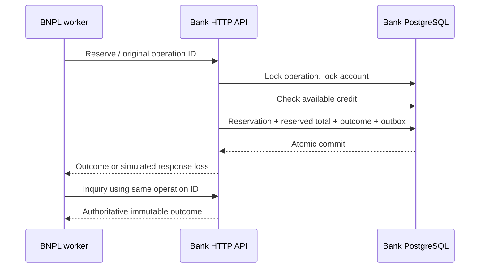

# Bank boundary

The bank is authoritative for `cash`, `creditLimit`, `used`, `reserved`, reservations, operations, journals and simulation logs. Runtime `crediflow_bank` can access only the bank schema. Runtime `crediflow_bnpl` can access only identity and BNPL schemas. PostgreSQL integration tests prove the cross-schema reads are denied.

Availability is `creditLimit - used - reserved`. Cash never goes negative. Constraint triggers require account totals to equal the associated reservation balances. Bank administrators change cash through adjustment operations and double-entry journals; credit changes cannot fall below used plus reserved credit. Frozen accounts reject financing and payments but can release an unused authorization.

The first payment atomically removes the full reserved amount, collects cash, and sets used credit to purchase total less the first installment. Separate commit and cash collection cannot leave an intermediate financed debt. The commit HTTP alias therefore requires the first installment amount and performs both effects together. Later repayments decrease cash and outstanding principal by the same amount.

Simulator outcomes are exclusive: HTTP error, pre-commit timeout, committed-response loss, retryable unavailability, or healthy. Explicit next-operation scenarios override probability settings. They never bypass balance, frozen-account or credit invariants. Injected timeouts return HTTP 504; the client also has an actual fetch deadline. Delay timers simulate an HTTP call only and do not schedule durable work.
