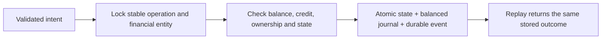

# Financial invariants

| Invariant                                           | Enforcement                                                                | Local evidence                                       |
| --------------------------------------------------- | -------------------------------------------------------------------------- | ---------------------------------------------------- |
| Whole AMD, no monetary float arithmetic             | BigInt amounts; decimal-string HTTP schemas                                | Schedule unit tests and payment integration tests    |
| No negative cash, debt or reserved credit           | PostgreSQL CHECK constraints                                               | Debit and credit transaction assertions              |
| Used + reserved never exceeds credit limit          | CHECK plus per-account transaction locks                                   | Concurrent reservation race                          |
| Stored credit totals equal reservation totals       | Deferred PostgreSQL constraint triggers                                    | Migration applied; integration workflows pass        |
| One intended debit per installment                  | Purchase lock; stable intent; partial unique index; bank operation PK/hash | 100 concurrent payment requests                      |
| Idempotency key cannot change intent                | Canonical hash stored with scoped key                                      | Conflicting checkout/payment test                    |
| Every journal balances and has at least two entries | Deferred journal and entry triggers                                        | Unbalanced insertion rejected                        |
| Posted journals and outcomes are immutable          | Triggers plus restricted grants                                            | Mutation rejection test                              |
| New entries cannot extend an old posted journal     | Transaction-ID insertion guard                                             | Applied migration; further adversarial tests pending |
| Customer amounts and ownership come from the server | Catalog snapshots, stored installments and user relationship               | Server-price manipulation and role tests             |
| Unknown outcomes never authorize a new debit        | Persistent pending state and original-ID bank inquiry                      | Committed-response-loss recovery                     |
| Bank and BNPL have independent write boundaries     | Separate schemas and credentials                                           | Cross-schema queries denied                          |

Correctness is local to each transaction. Cross-domain delivery is recoverable and idempotent, not a distributed PostgreSQL transaction. No transaction stays open while waiting for bank HTTP.
