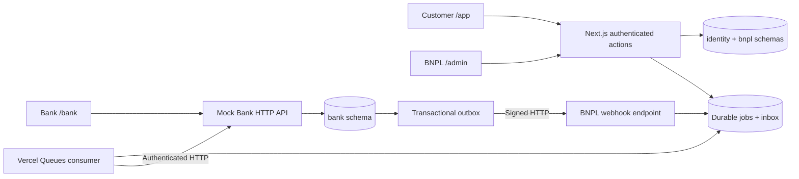

# System overview

CrediFlow is a modular monolith. A single Next.js deployment hosts browser portals and versioned HTTP APIs. The bank has its own persistent schema and runtime credential; BNPL services never write bank balance tables. The migration owner is separate from both runtime roles.

Identity uses Better Auth and database-backed sessions and rate limits. Commerce owns price snapshots, inventory, requests and decisions. Installments and payments own economic intents. Banking owns cash, credit, reservations and authoritative outcomes. Ledger services post balanced immutable journals. Reliability services own leased jobs, outbox/inbox processing and reconciliation.

PostgreSQL advisory transaction locks serialize a purchase, account or operation. No remote HTTP request is issued while a financial database transaction is open. HTTP status inquiries recover ambiguous cross-domain outcomes. The local worker polls an authenticated HTTP endpoint; production uses managed Queues plus a daily cron recovery entry point. Local filesystem data is never a production database.

The hosted deployment and managed delivery infrastructure still require live verification. The milestone includes a persistent server-side cart and an activity chart from stored payments. Refunds and production email delivery remain pending.
