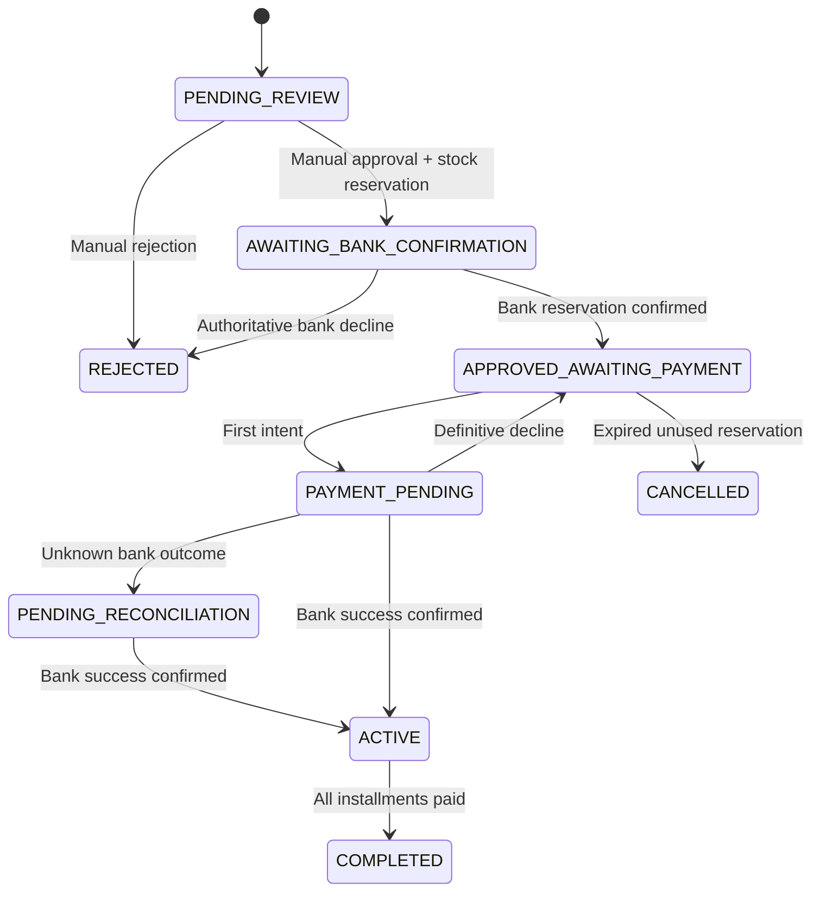

# Payments and accounting

All amounts are integer whole Armenian drams, serialized as decimal strings over HTTP. Monetary arithmetic uses `bigint`. Four- and six-payment schedules distribute indivisible remainders to the earliest installments. Due dates use UTC calendar days at noon, clamped to the target month's last day and restored to the original day in later months. The schedule is anchored to successful first-payment confirmation.

A stable payment intent, canonical request hash, unique idempotency record and purchase lock protect repeated clicks. A partial unique index permits only one non-declined intent per installment. A new attempt is allowed only after an authoritative decline. A timeout retains the same intent and bank operation ID. Workers inquire before resending and never infer failure from a transport error.

At activation, BNPL debits customer receivable and credits merchant payable for the whole price. Merchant settlement debits merchant payable and credits simulated provider funding. Customer collections debit bank cash and credit customer receivable. Bank origination debits loan receivable and credits provider funding; deposit collection and principal reduction are separately balanced journals. Cash adjustments post against a simulated treasury account. Authorization itself is a non-posting reservation.

For a 240,000 AMD purchase with four installments and 100,000 cash: reserve 240,000; collect 60,000; reserved becomes zero; cash becomes 40,000; principal becomes 180,000; available credit on a 500,000 limit becomes 320,000. Tests verify these values.

Failed attempts post nothing. Financial history rejects edits and deletion. Reversals and refunds would require dedicated compensating journals; those workflows are not implemented and no refund button claims otherwise.
