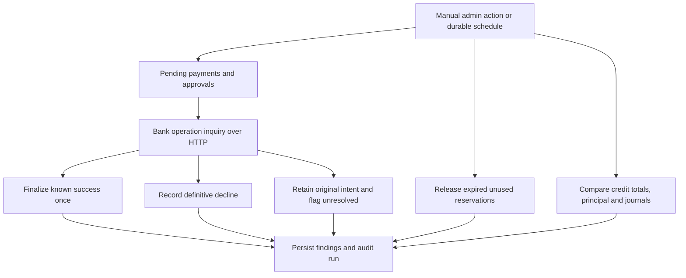

# Reconciliation and recovery

Reconciliation checks authoritative bank outcomes for uncertain payments and approvals. It releases expired unused reservations, restores reserved inventory, verifies bank account totals against reservation sums, compares committed reservation principal with unpaid installments, detects orphaned bank reservations/payments, and checks journal balancing. Findings are persisted as `MATCHED` or `NEEDS_REVIEW` and corrections are audited. Repeated runs do not repeat postings.

Jobs hold expiring database leases and stable economic references. A crashed invocation leaves work recoverable when its lease expires. Retries are bounded, with dead jobs visible for manual investigation. The deterministic interruption control withholds acknowledgment before financial processing or after ledger commit; it records an interrupted attempt and leaves the lease for a later invocation. This is a controlled interruption simulation, not a claim that an operating-system process was killed during tests.

The managed consumer schedules another durable tick after each run. A daily Vercel cron and explicit administrator retry provide recovery entry points if a heartbeat fails. Live managed queue processing and response-loss recovery have been verified. Notifications use independent identities so later commits cannot be suppressed by an earlier consumed wakeup. The local worker is a development process only.
