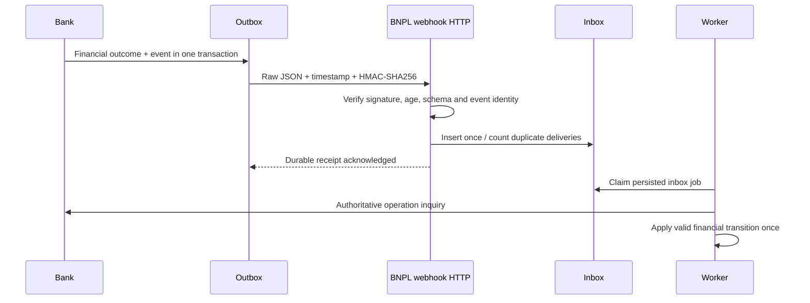

# Webhooks

Signatures cover `timestamp.rawBody` using the current webhook secret. The receiver accepts current or previous secrets, uses constant-time comparison, and rejects timestamps beyond five minutes. Event IDs remain deduplicated indefinitely. An event ID reused with another normalized payload is rejected. Delivery metadata and financial operation identities are distinct.

Bank events are committed in the financial transaction. Delivery attempts and their HTTP results are stored. Retries use exponential backoff and jitter with a bounded dead state; administrators can replay the original event. The event-specific webhook-failure scenario fails its first two deliveries; a configured 100% failure rate persists until settings change. Duplicate delivery is expected.

The out-of-order scenario sends a successful operation before a delayed older pending event. Inbox workers query current bank status; an old message cannot overwrite a successful payment. Webhook acknowledgment follows durable inbox insertion, not financial processing. Lost notifications can also be recovered through reconciliation.

The outbox is drained by the durable coordinator through authenticated HTTP. Concurrent drains can produce duplicate deliveries by design. Exactly-once economic effects come from database constraints and idempotent posting, not an exactly-once delivery assumption.
